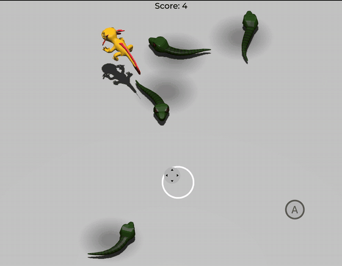

# Save the Axolotl: Snake Stomp

This is a simple 3D game where you guide an axolotl around an arena,
jump on snakes to stomp them, and survive as long as you can. You gain
1 point for every snake stomped.

Controls:

- <kbd>Up Arrow</kbd>, <kbd>W</kbd>, <kbd>Gamepad Left Stick</kbd>, <kbd>On-screen thumbstick</kbd>: Move up
- <kbd>Down Arrow</kbd>, <kbd>S</kbd>, <kbd>Gamepad Left Stick</kbd>, <kbd>On-screen thumbstick</kbd>: Move down
- <kbd>Left Arrow</kbd>, <kbd>Gamepad Left Stick</kbd>, <kbd>On-screen thumbstick</kbd>: Move left
- <kbd>Right Arrow</kbd>, <kbd>Gamepad Left Stick</kbd>, <kbd>On-screen thumbstick</kbd>: Move right
- <kbd>Space</kbd>, <kbd>Gamepad A/Cross</kbd>, <kbd>On-screen jump button</kbd>: Jump

This is the finished version of the game featured in the
["Your first 3D game"](https://docs.xogot.com/documentation/tutorials/your-first-3d-game)
tutorial in the Xogot documentation. For more details, follow the tutorial
there.

This demo covers:

- Handling player input, including touch controls via the Virtual Joystick add-on.
- Moving and jumping in a 3D game.
- Spawning enemies randomly around the game arena.
- Using the built-in animation editor to breathe life into your game.
- Creating a complete game loop with lose conditions, score, and the ability to restart.

Language: GDScript

Renderer: Forward+

## Screenshots

## Copying

`art/House In a Forest Loop.ogg` Copyright &copy; 2012 [HorrorPen](https://opengameart.org/users/horrorpen), [CC-BY 3.0: Attribution](https://creativecommons.org/licenses/by/3.0/). Source: https://opengameart.org/content/loop-house-in-a-forest

Font is "Montserrat Medium". Copyright 2011 [The Montserrat Project Authors](https://github.com/JulietaUla/Montserrat). Details are in `fonts/LICENSE.txt`.
